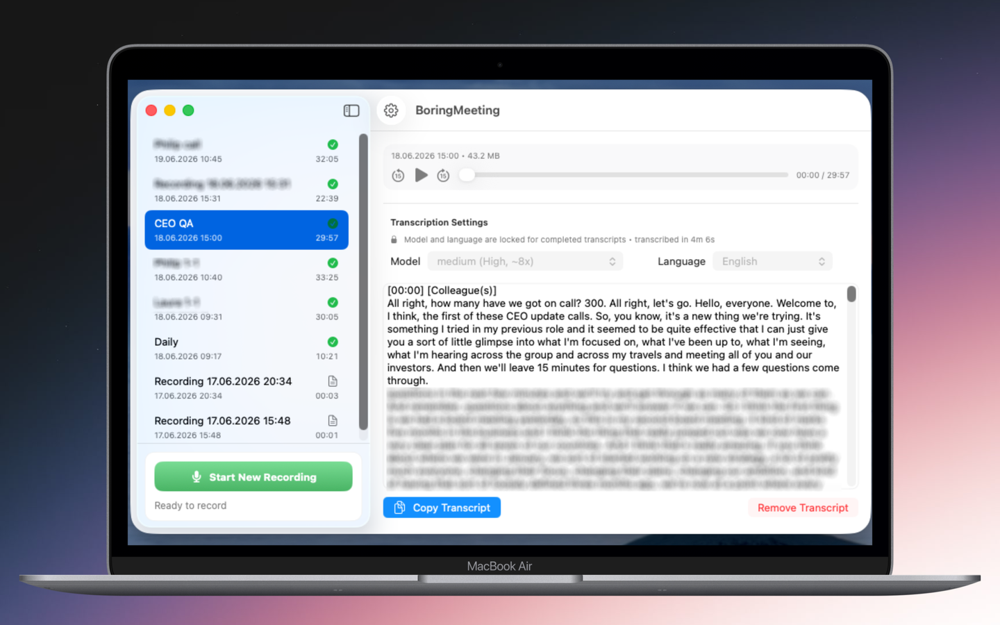
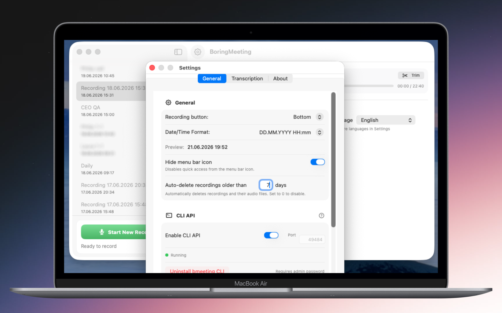

# BoringMeeting

A macOS menu bar app that records your meetings (microphone + system audio) and transcribes them locally with [WhisperKit](https://github.com/argmaxinc/WhisperKit). Your recordings and transcripts never leave your Mac.

Website: https://ninilich.github.io/boring-meeting · [Download on the App Store](https://apps.apple.com/us/app/boringmeeting/id6760206449?mt=12)

<p>
  
  
</p>

## Features

- Record microphone and system audio via ScreenCaptureKit
- Local transcription with Whisper models (tiny to large-v3 turbo, English-only variants, distil-large-v3)
- Split Audio Sources mode: separate transcription of microphone and system audio with custom speaker labels
- Batch transcription of multiple recordings
- Meeting history with rename, multi-select and bulk delete
- Trim recordings, auto-delete old recordings
- Local HTTP API and the `bmeeting` CLI for scripts and AI assistants

## Requirements

- Apple Silicon Mac (M1 or newer)
- macOS 15+
- Xcode 16+ to build from source

## Unsigned builds from GitHub Releases

Every version bump on `main` publishes an unsigned DMG on the [Releases](https://github.com/ninilich/boring-meeting/releases) page, with a `.sha256` file to verify the download. These builds are not signed or notarized, so macOS blocks the first launch:

1. Drag `BoringMeeting.app` to Applications and try to open it once.
2. Open System Settings > Privacy & Security and click **Open Anyway** next to BoringMeeting.

Or remove the quarantine flag in Terminal: `xattr -dr com.apple.quarantine /Applications/BoringMeeting.app`.

## Build from source

```bash
git clone https://github.com/ninilich/boring-meeting.git
cd boring-meeting
xcodebuild -scheme BoringMeeting -destination 'platform=macOS' build
```

Or open `BoringMeeting.xcodeproj` in Xcode and press Run. The Debug configuration builds without code signing.

To run a signed build, or to produce a Release build, change these in the Xcode project to your own values:

- `DEVELOPMENT_TEAM`
- `PRODUCT_BUNDLE_IDENTIFIER` (default `org.ninil.boringmeeting`, also for the test targets)

`./build_app.sh --help` lists the available build modes.

## CLI (`bmeeting`)

The app embeds a local HTTP server (loopback only, default port `49484`) and a companion CLI. Enable the API and install the CLI in Settings > General > CLI API.

```bash
bmeeting list                        # all meetings (JSON)
bmeeting list --format text          # human-readable
bmeeting info <id>                   # meeting details
bmeeting transcribe <id> --wait      # start transcription and wait for it
bmeeting transcript <id>             # print the transcript
bmeeting rename <id> "New title"     # rename a meeting
```

Set `BMEETING_PORT` to override the port.

## Privacy

Audio, recordings and transcripts stay on your device. The app downloads Whisper models from Hugging Face and checks for updates through the App Store. It also sends one anonymous heartbeat per day (truncated hash of the device UUID and the app version) via [Heartbeat](https://github.com/maierru/heartbeat-tracker). Details are in the [privacy policy](privacy-policy.md).

If you fork the project, change the bundle identifier or remove `Heartbeat.start()` in `AppDelegate.swift`, otherwise your builds will be counted in the original app's statistics.

## Contributing

See [CONTRIBUTING.md](CONTRIBUTING.md). Security issues: [SECURITY.md](SECURITY.md).

## License

[GPL-3.0](LICENSE)
